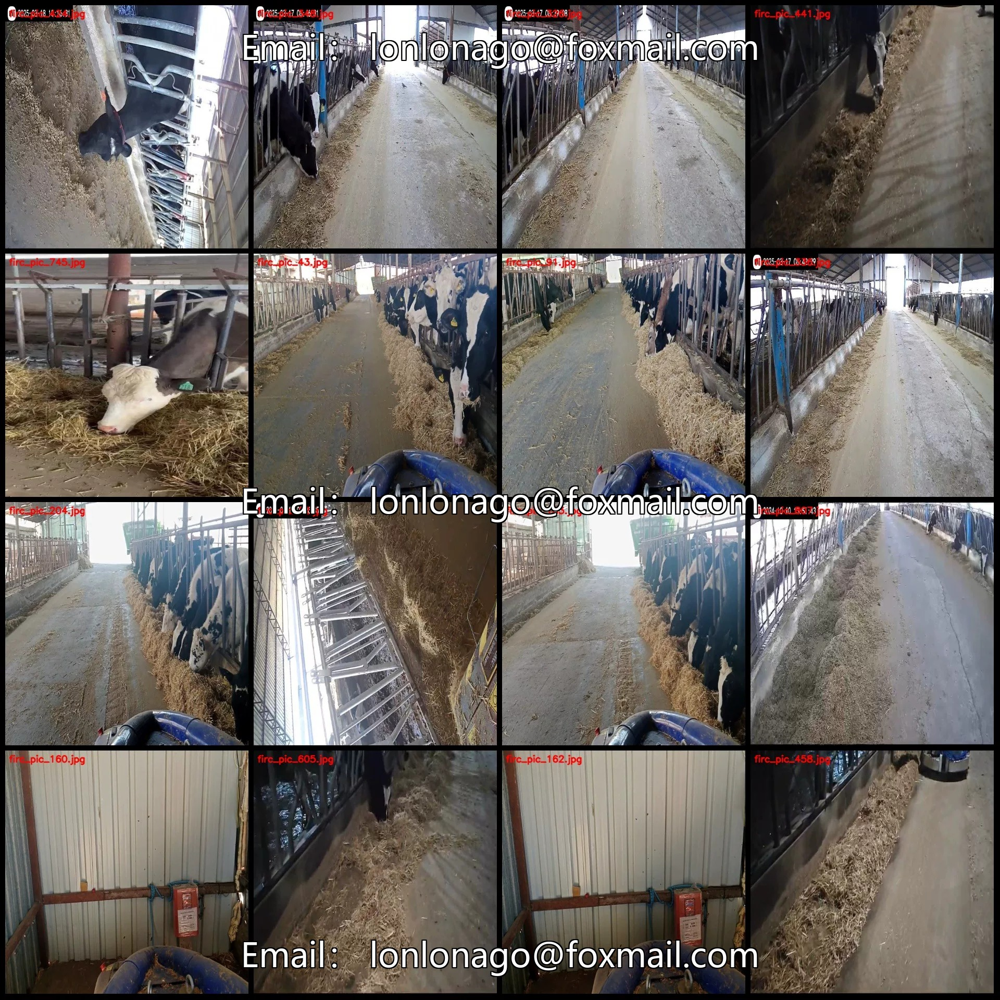
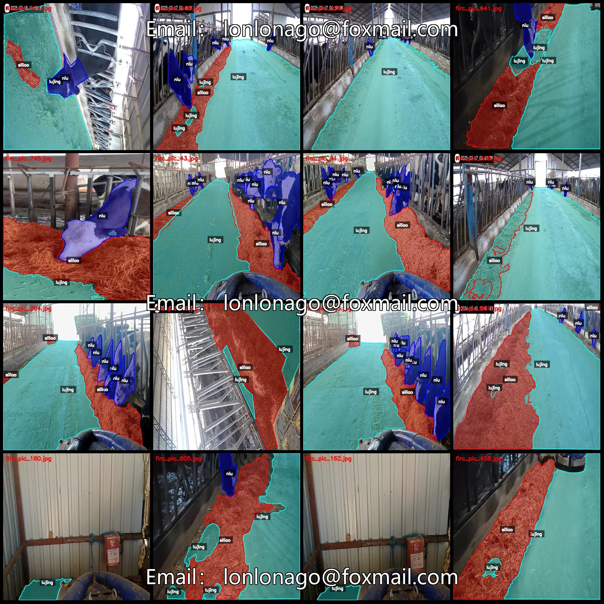
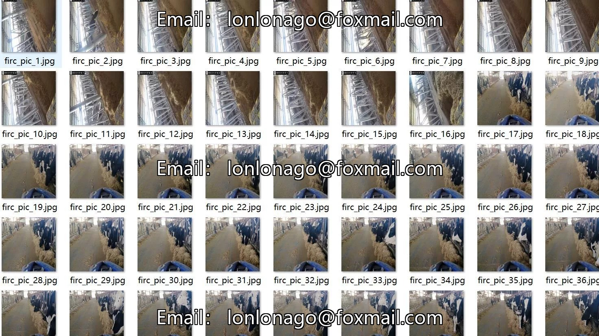
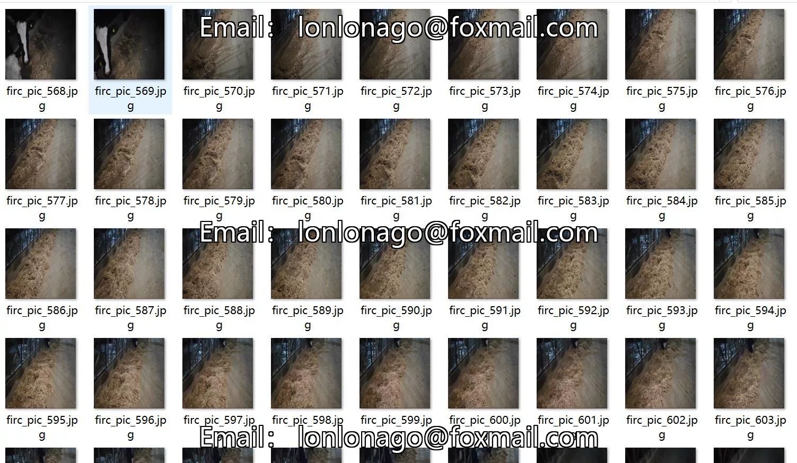
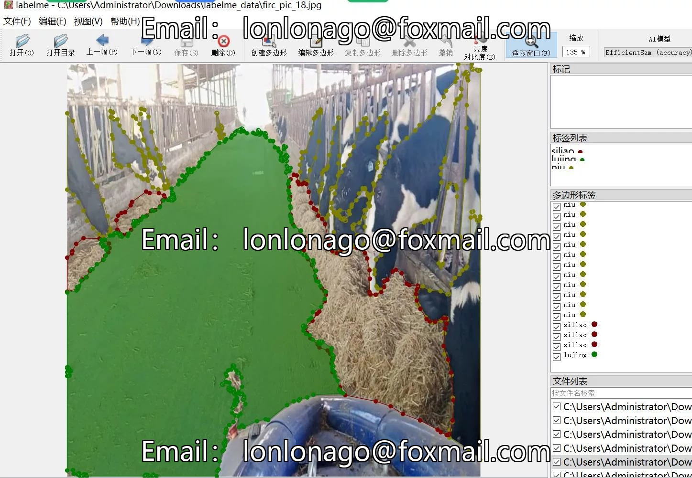
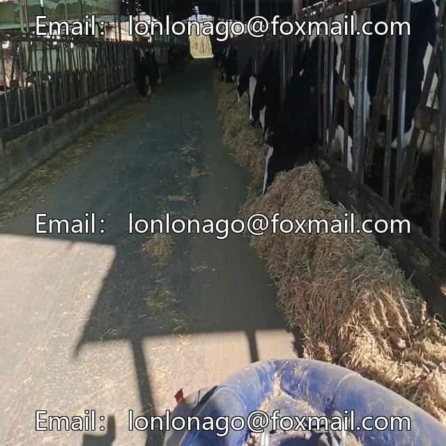
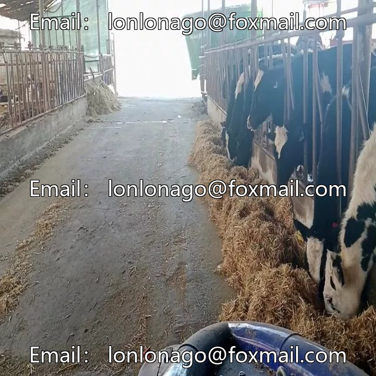
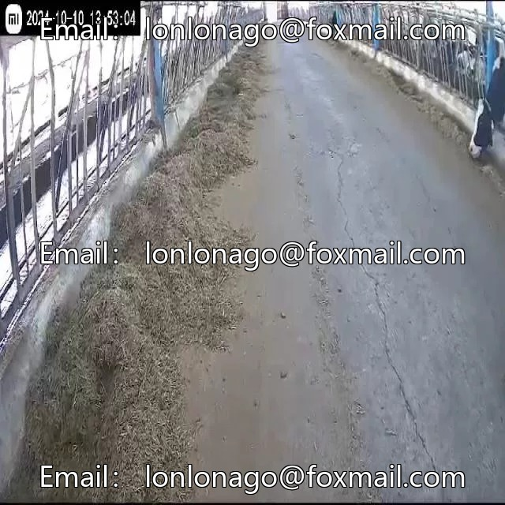

# A herd of cattle feed path identification and segmentation dataset in labelme format, 829 images

## Body

A cow farm dataset for path recognition and segmentation in labelme format with 829 images across 3 categories.

Please note: Due to the dataset's reproducibility, after purchase, please confirm compliance before purchasing.

Dataset format: Labelme (without mask files, only including jpg images and corresponding json files)
Number of images (number of jpg files): 829
Number of annotations (number of json files): 829
Number of annotation categories: 3
Annotation category names: ["lujing", "niu", "siliao"]
Corresponding Chinese category names: ["path", "cow", "feed"]
Each category annotated boxes and image counts

Lujing box count = 1260, occupying image count = 810
Niu box count = 2900, occupying image count = 544
Siliao box count = 1230, occupying image count = 719
Total box count: 5390
Using labelme tool: labelme=5.5.0
Image resolution: 640x640
Annotation rules: Polygons are drawn around the categories.
Important Note: The dataset can be opened and edited using labelme. JSON datasets need to be converted into mask or yolo format or coco format for semantic segmentation or instance segmentation.
Special Statement: This dataset does not guarantee the accuracy of the trained models or weight files.

## Images

## Payment

Here is a pay link on Stripe ( https://buy.stripe.com/3cs8yP7sY87d0vu9AB ). Please contact me lonlonago@foxmail.com after funding $89, and I will send you a complete data files , thank you!

